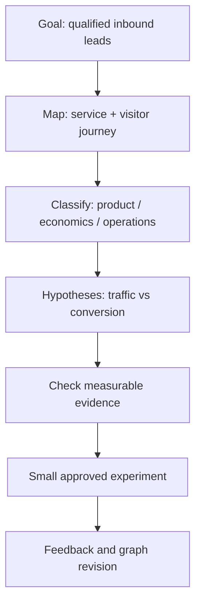

# QDCM v0.1 — QuantDeus Cognitive Mapping

**Status:** proposal / opt-in pilot only  
**Scope:** shared analysis protocol for the QuantDeus AI Fleet, not a replacement for `AGENTS.md`, the active doctrine, or authority/approval gates.  
**Source:** founder's method: **mind map → classification by discipline → visualization of dependencies → synthesis → measured feedback**.

## Goal

Turn an ambiguous task into a structured, inspectable, interdisciplinary reasoning artifact. Each stage must add a distinct product: the result is a graph of hypotheses and decisions, not a persuasive narrative or fabricated certainty.

QDCM operates in **read/recommendation mode by default**. It does not grant new tools, permissions, spending, publishing, deploy, external messaging, privileged modifications or autonomous high-impact actions.

## Pipeline

1. **Frame** — state the user goal, the scope, decision owner, success criteria, constraints, known facts, and missing information.
2. **Map** — list concepts as short nodes. Distinguish needs, resources, people/roles, events, constraints, outcomes, and uncertainties. Never turn interpretation into observation.
3. **Classify** — assign each node one or more domains: psychology, economics, family/social, governance, technology/engineering, product, legal/privacy, operations, or research. Additional domain labels are permitted with a definition.
4. **Connect** — build *typed* edges: `depends_on`, `supports`, `conflicts_with`, `causes_hypothetically`, `mitigates`, `owned_by`, `measures`. Direction must be explicit. Tag causal links as hypotheses until independently tested.
5. **Visualize** — output Mermaid (or another accessible graph representation) **plus a text adjacency/edge list** so the diagram remains usable without graphics.
6. **Challenge** — produce at least two competing explanations for uncertain causal relationships; record falsifiers, evidence gaps and what evidence would change a conclusion.
7. **Synthesize** — rank *reversible, permissioned* next experiments by expected value, effort, risk, and measurable success criteria. Include the smallest useful first step.
8. **Feedback** — compare predictions with observed results; revise graph confidence and mark disproven links. No automatic promotion from hypothesis to fact.

## Minimal machine-readable contract (JSON)

```json
{
  "schema_version": "qdcm-v0.1",
  "task_id": "example-001",
  "objective": "Increase qualified inbound leads for an opt-in service",
  "decision_owner": "human",
  "scope": "recommendation_only",
  "nodes": [
    {"id": "n1", "label": "Service landing page", "kind": "resource", "domains": ["product"], "epistemic_status": "observed", "evidence": ["approved-public-page"]},
    {"id": "n2", "label": "Lead requests", "kind": "outcome", "domains": ["economics", "product"], "epistemic_status": "unknown", "evidence": []}
  ],
  "edges": [
    {"from": "n1", "to": "n2", "relation": "causes_hypothetically", "epistemic_status": "hypothesis", "evidence": []}
  ],
  "alternatives": [
    {"id": "h1", "claim": "Landing page is a lead bottleneck", "falsifier": "Conversion is already high on valid measured traffic"},
    {"id": "h2", "claim": "Traffic quality is the lead bottleneck", "falsifier": "Qualified visits increase but qualified leads do not"}
  ],
  "experiment": {
    "action": "Audit existing funnel metrics before edits",
    "owner": "human_or_authorized_agent",
    "requires_approval": false,
    "success_metric": "Baseline conversion and sample size recorded",
    "rollback": "No production write"
  },
  "limitations": ["Metrics are not yet available"]
}
```

### Validation invariants

- Every edge references existing node IDs and carries a typed relation.
- Claims use `observed`, `sourced`, `hypothesis`, `unknown`, or `disproven`; never call an inference `observed`.
- Every assertion relying on external data has a traceable public-safe source, or explicitly says `unknown`. If no evidence is available, do not invent it.
- At least one disconfirming observation is defined for each high-impact hypothesis.
- Every recommended experiment has an owner, success metric, risks, and permission status. Mutation, high-impact actions, outreach, paid tools and publication obey existing Human Override, budgets and auth constraints.
- Do not disclose personal, family, health, payment, contact, private-chat or secret details in public GitHub artifacts. Personal analyses stay in private approved channels; use synthetic examples in tests.
- QDCM can analyze negotiation and empathy but must not generate covert psychological profiles or manipulate unwilling participants.
- Maintain human-readable fallback; Mermaid or graph UI must not be the sole source of meaning.

## Mermaid example



## Roles and handoffs

- **Seven of Nine** — QDCM intake, boundaries, accountable coordinator and minimal next authorized action.
- **Sherlock Holmes** — candidate concept map, anomalies and alternative hypotheses.
- **Tuvok** — logical soundness, epistemic labels and falsification checks.
- **Lt. Cmdr. Data** — consistency of graph, typed edges, metrics and contradictions.
- **EMH** — respectful negotiation, user autonomy and de-escalation where human needs are involved; no diagnosis or covert profiling.
- **Implementation/QA agents** — opt-in proof-of-concept parser, schema tests, a renderer, accessible text fallback, security review and reproducible evidence.

The executor must not assume that documentation alone changes existing agent behavior. The protocol only becomes mandatory after human review, guarded implementation, QA and merge into the source-of-truth lane.

## MVP acceptance criteria

- [ ] Input: one short task statement → JSON object satisfying the contract and Mermaid diagram.
- [ ] At least two domain classifications for a cross-disciplinary task.
- [ ] At least two alternative hypotheses plus potential falsifiers.
- [ ] Explicit `unknown` for missing evidence, never fake citations.
- [ ] Edge references and confidence statuses validated by automated tests.
- [ ] Text fallback accurately mirrors all diagram connections.
- [ ] Three test fixtures: business automation, software defect, and fictional interpersonal negotiation.
- [ ] Sensitive or unauthorized actions yield a small safe analysis/handoff, not tool execution.
- [ ] Side-by-side comparison with the existing workflow on accuracy, actionability, unnecessary tokens and hallucinated edges.
- [ ] Human review + independent QA before activating protocol for all agents.

## Proposed phased rollout

**P0:** document contract, synthetic fixtures, no runtime change.  
**P1:** standalone CLI/parser + tests and static Mermaid/text output; optional pilot for Sherlock/Tuvok/Data.  
**P2:** Seven/EMH review and integration with existing agent contracts, only through a separate reviewed PR.  
**P3:** measure whether QDCM improves task throughput and decision quality; retire it if measurements fail.

Success is measured by actionable decisions and verified feedback, not graph size or agent count.
