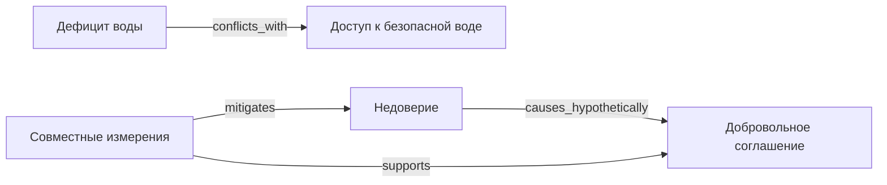

<!-- Auto-generated reference report from synthetic fixture; deterministic demo, not external factual evidence. -->

# PeaceLab: Два берега озера Миран — вымышленный конфликт о воде

**Scope:** fictional_training_only  
**Decision owner:** human_mediator

> Scenario data are invented. A candidate is NOT an approved agreement or evidence of real-world feasibility.

## Ментальная карта (Mermaid)

## Доступный текстовый граф
- water —conflicts_with→ safety (sourced)
- trust —causes_hypothetically→ agreement (hypothesis)
- monitor —mitigates→ trust (hypothesis)
- monitor —supports→ agreement (hypothesis)

## Дисциплины
diplomacy · ecology · economics · engineering · governance · health · human_rights · psychology

## Конкурирующие гипотезы
- **h1** Публичные измерения снижают недоверие; опровергающее наблюдение: После независимых измерений доверие участников не меняется
- **h2** Главное препятствие — не дефицит, а непрозрачные правила; опровергающее наблюдение: Даже после согласования прозрачных правил сохраняется объективная нехватка питьевой воды

## Варианты (аналитика, не согласованные решения)

### Сезонные квоты и совместный контроль
**Статус:** candidate_for_dialogue
Опубликовать совместный водный баланс и согласовать гибкие сезонные квоты с обязательным минимумом питьевой воды.

- Возможные риски: Ошибки измерения; Недоверие к комиссии
- Контроль: Приоритет питьевой воды; Независимое измерение и открытая отчётность; Право пересмотра соглашения
- Показатели: Доля дней с доступом к питьевой воде; Число зафиксированных нарушений квот
- Согласие: not_obtained (статус включения участников не доказывает согласие)

### 30-дневный пилот общего диспетчерского совета
**Статус:** candidate_for_dialogue
Создать временный совместный совет и проверить правила распределения с публичными показаниями датчиков.

- Возможные риски: Технический сбой датчиков; Недостаточное представительство
- Контроль: Срочная гуманитарная оговорка; Возможность остановить пилот; Равное участие представителей
- Показатели: Соблюдение минимального доступа к воде; Количество рассмотренных жалоб
- Согласие: not_obtained (статус включения участников не доказывает согласие)

### Добровольный независимый арбитраж
**Статус:** candidate_for_dialogue
Пока стороны ведут переговоры с нейтральными посредниками, сохранить согласованный временный минимум воды.

- Возможные риски: Затяжные переговоры; Неравная переговорная сила
- Контроль: Публичное описание процедуры; Свободный выход; Временное обеспечение основных нужд
- Показатели: Доля принятых совместно процедур; Число дней до первого согласованного шага
- Согласие: not_obtained (статус включения участников не доказывает согласие)

### Одностороннее перекрытие подачи
**Статус:** blocked_rights
Одна сторона отключает воду другой без её согласия.

- Возможные риски: Гуманитарный ущерб; Эскалация
- Контроль: не предусмотрен
- Показатели: Неприемлемо как мирное решение
- Согласие: not_obtained (статус включения участников не доказывает согласие)
- **Нарушенные ограничения:** civilian_safety, voluntary_consent, non_discrimination, access_to_essentials
- **Не представлены:** south, residents

## Неопределённости
- Нет реальных измерений: все количества в примере условны
- Согласие ни одной стороны пока не получено
- Проверка правовых и инженерных норм в реальном мире не проводилась

**Следующий шаг:** Human facilitators should first verify assumptions and obtain informed consent before any real-world use.
